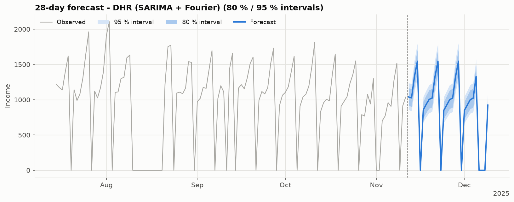
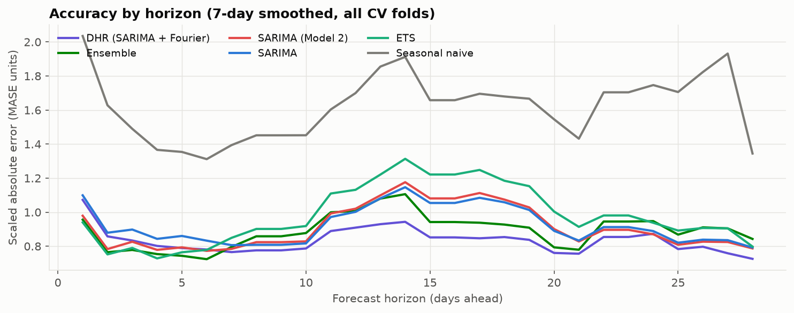
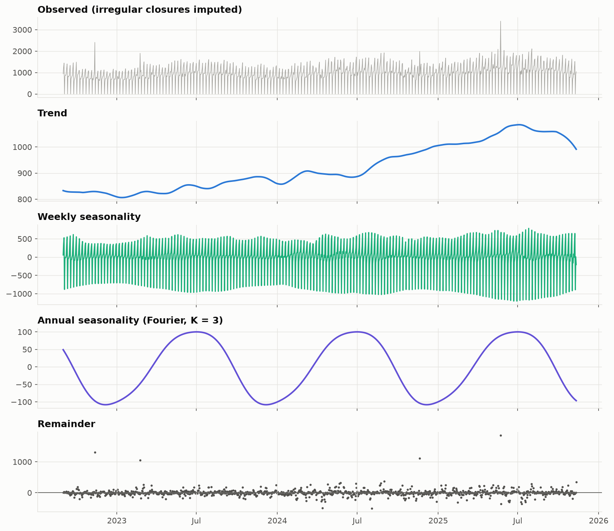
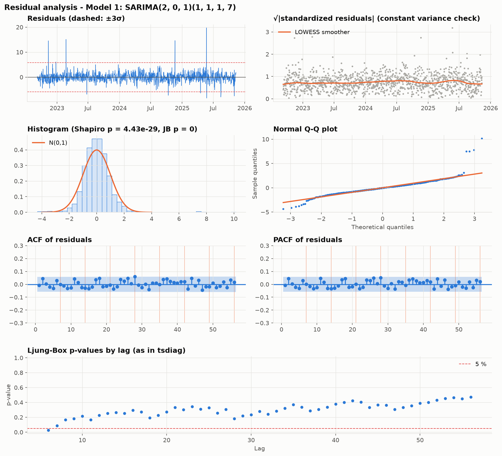

# Income_TS — time-series analysis of a local store's daily income

A reproducible pipeline that turns a daily income file (`Date, Income`) into a full
statistical report: exploratory analysis, Box–Jenkins identification, SARIMA estimation and
validation, outlier and calendar treatment, a comparison of forecasting methods with
rolling-origin cross-validation, and a forecast with prediction intervals.

## Example report

**→ [Full example report](examples/synthetic/REPORT.md)**, generated from a **synthetic** 3.2-year
series (`tools/make_synthetic.py`) because the real store's data are private. On that series,
dynamic harmonic regression (SARIMA errors + annual Fourier terms) is the most accurate model in
rolling-origin cross-validation, with 48 % lower scaled error than the seasonal naive benchmark
and well-calibrated 95 % intervals.

| Forecast with prediction intervals | Out-of-sample accuracy by horizon |
|:--:|:--:|
|  |  |
| **Decomposition (trend, weekly, annual)** | **SARIMA residual validation** |
|  |  |

> **Privacy.** The pipeline is also run on a real store's income, but those data, outputs and
> reports stay local: `*.csv`, `*.ods`, `outputs/` and the root `REPORT.md` / `report/` are
> git-ignored, and notebook outputs are stripped on commit.

## Quick start

```bash
pip install -r requirements.txt
python3 run_analysis.py                 # reads income_data.csv, writes REPORT.md (~5-10 min)
python3 run_analysis.py --fast          # smaller grid, 3 CV folds (~2-3 min)
```

Useful options:

| Option | Default | Meaning |
|:--|:--|:--|
| `--data PATH` | `income_data.csv` | input file with columns `Date`, `Income` |
| `--dayfirst` | off | parse dates as DD/MM/YYYY |
| `--horizon N` | 28 | forecast horizon evaluated in cross-validation (days) |
| `--folds N` | 6 | rolling-origin folds |
| `--forecast-days N` | = horizon | length of the final forecast |
| `--region` | `catalonia` | holiday calendar: `spain`, `catalonia`, `barcelona`, `none` |
| `--outlier-crit T` | 3.5 | \|t\| threshold for AO/LS/TC outliers |

Try it without real data: `python3 tools/make_synthetic.py /tmp/demo.csv && python3 run_analysis.py --data /tmp/demo.csv --out /tmp/demo`.

## What the analysis does

| Step | Methods |
|:--|:--|
| Cleaning | complete daily calendar; regular closing weekdays detected automatically; irregular closures flagged; missing days imputed from the same weekday |
| Exploration | series + rolling mean/sd, weekday & month profiles, calendar heatmap, seasonal plot by year, yearly totals, HAC trend test |
| Transformation | Box–Cox (ML, with CI) and Guerrero λ on open days, mean–sd plot → none or √ (zeros rule out the log) |
| Stationarity | ADF + KPSS on each differencing level, variance of each difference (over-differencing check), seasonal strength rule for D |
| Decomposition | robust STL (s = 7) + annual Fourier component, strengths of trend/seasonality, periodogram, ACF/PACF |
| Estimation | SARIMA(p,d,q)(P,D,Q)₇ with holiday/closure regressors, AICc grid; two candidate models (best AICc, best BIC) |
| Validation | AR/MA root moduli (causality, invertibility), ψ and π weights, residual plots, √\|e\| smoother, Shapiro–Wilk, Jarque–Bera, Ljung–Box by lag, ARCH LM, coefficient stability |
| Outliers | iterative AO / LS / TC detection (Chen–Liu, π-weighted), linearized series, hold-out check of whether treating them helps |
| Other models | seasonal naive/mean benchmarks, ETS (additive, damped trend), dynamic harmonic regression (SARIMA errors + annual Fourier), gradient boosting (direct, quantile intervals), ensemble |
| Evaluation | expanding-window rolling-origin CV; MASE, MAE, RMSE, WAPE, MAPE, RMSPE, bias, interval coverage and width; Diebold–Mariano tests; error by horizon |
| Forecast | best model refit on all data; model or CV-calibrated empirical intervals; weekly totals |
| Monthly view | course-style SARIMA(·)(·)₁₂ on monthly totals with a trading-day regressor (needs ≥ 36 months) |

## Layout

```
run_analysis.py          entry point (CLI)
income_ts/
  data.py                loading, calendar completion, closures, imputation
  calendar.py            Spanish / Catalan / Barcelona public holidays (Easter computed)
  eda.py                 exploration, transformation, stationarity, decomposition, ACF/PACF
  models.py              SARIMA, validation, outliers, DHR, ETS, gradient boosting, baselines
  evaluation.py          rolling-origin CV, accuracy measures, Diebold–Mariano
  monthly.py             monthly SARIMA with trading days
  plots.py, style.py     figures
  report.py              REPORT.md template; every sentence is generated from the results
tools/
  make_synthetic.py      synthetic data with the same schema (for testing / demos)
  strip_notebook.py      git filter that removes notebook outputs
examples/synthetic/       example report built from synthetic data
analysis.ipynb, plot_TS.py   first exploratory version
```

## Sharing the report

`REPORT.md` and `report/` are git-ignored because they contain values derived from the private
data. To share a specific run deliberately, force-add it: `git add -f REPORT.md report/figures`.
