# Daily income of a store (synthetic example) — time-series analysis

> [!NOTE]
> **Synthetic data.** This report was generated from a simulated series (`python3 tools/make_synthetic.py data.csv --years 3.2 --seed 1`) to demonstrate the pipeline. The real store's data and results are private.

*Report generated automatically by `run_analysis.py` on 2026-11-23 19:32 (run time 335 s).
Every number and sentence below is computed from the data; re-running the script refreshes the report.*

**Data:** 2022-09-01 → 2025-11-11 · 1,168 days (3.2 years) ·
**Horizon evaluated:** 28 days · **Best model:** DHR (SARIMA + Fourier)

## Executive summary

- Mean income on an open day is **1,078** (median 1,022,
  coefficient of variation 28 %). Total income in the sample: 1,010,181.
- A linear fit to the monthly means gives an upward trend of 81.8 per day per year (9.5 % of the mean level, HAC p = < 0.001), which is statistically significant. Income over the last 12 months is 16.2 % above the previous 12 months.
- The busiest weekday on average is **Saturday** (1,461) and the quietest open day is **Monday** (849), a ratio of 1.72×. By month, mean daily income peaks in **May** (1,045) and is lowest in **Dec** (693).
- Seasonality: weekly strength 0.93,
  annual strength 0.31, trend strength 0.37
  (0 = none, 1 = dominant).
- The most accurate method out of sample is **DHR (SARIMA + Fourier)** (MASE 0.827, WAPE 7.5 %), 48.3 % lower error than the seasonal naive benchmark. The Diebold–Mariano test confirms it is significantly more accurate than ETS, Gradient boosting. Its advantage over Seasonal naive, SARIMA is not statistically significant, so those are practically equivalent alternatives.
- Expected income over the next 28 days: **24,359** (80 % range of the daily sums: 21,410 – 27,381), -2.6 % vs the last 28 days and 0.6 % vs the same period last year.

## Contents

1. [Data and cleaning](#1-data-and-cleaning)
2. [Exploratory analysis](#2-exploratory-analysis)
3. [Identification](#3-identification-box-jenkins)
4. [Estimation](#4-estimation)
5. [Validation](#5-validation-of-the-sarima-models)
6. [Calendar effects and outliers](#6-calendar-effects-and-outliers)
7. [Forecast evaluation](#7-forecast-evaluation-rolling-origin-cross-validation)
8. [Forecast](#8-forecast)
9. [Monthly view](#9-monthly-view-sarima-with-s--12)
10. [Conclusions](#10-conclusions-and-recommendations)
11. [Appendix: methods](#appendix-methods)

## 1. Data and cleaning

| Item | Value |
|:--|--:|
| Rows in file | 1162 |
| Period | 2022-09-01 → 2025-11-11 |
| Calendar days | 1168 |
| Duplicate dates (summed) | 0 |
| Missing calendar days | 6 |
| Imputed open days | 6 |
| Zero-income days | 231 |
| Regular closing day(s) | Sunday |
| Irregular closures | 64 |
| Negative values | 0 |

the store is regularly closed on **Sunday** (zero or no income on ≥ 80 % of them); those days are set to 0 and forecast as 0; **64** zero-income days on normally open weekdays are treated as irregular closures (holidays, vacations) and modelled with dummies; **6** missing open days were imputed from the same weekday in neighbouring weeks.

## 2. Exploratory analysis

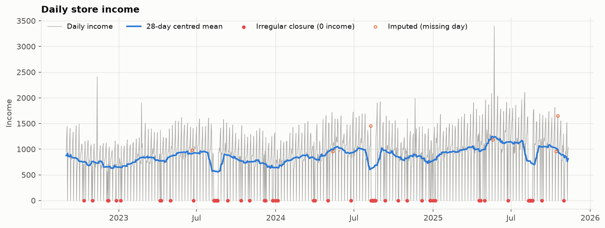

A linear fit to the monthly means gives an upward trend of 81.8 per day per year (9.5 % of the mean level, HAC p = < 0.001), which is statistically significant. Income over the last 12 months is 16.2 % above the previous 12 months.

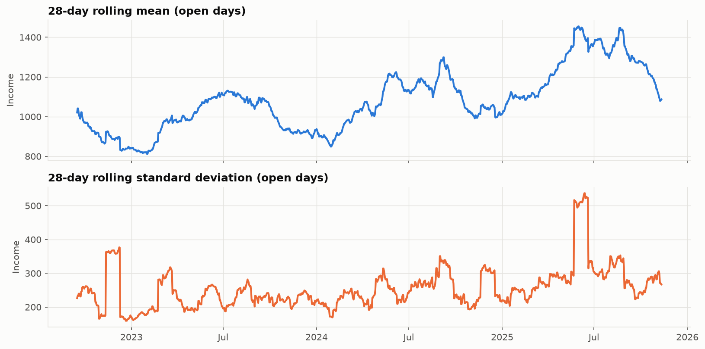

The rolling statistics show whether level and volatility drift over time: a moving mean
indicates trend (non-stationary in mean), a moving standard deviation that follows the mean
suggests a variance-stabilising transformation (section 3.1).

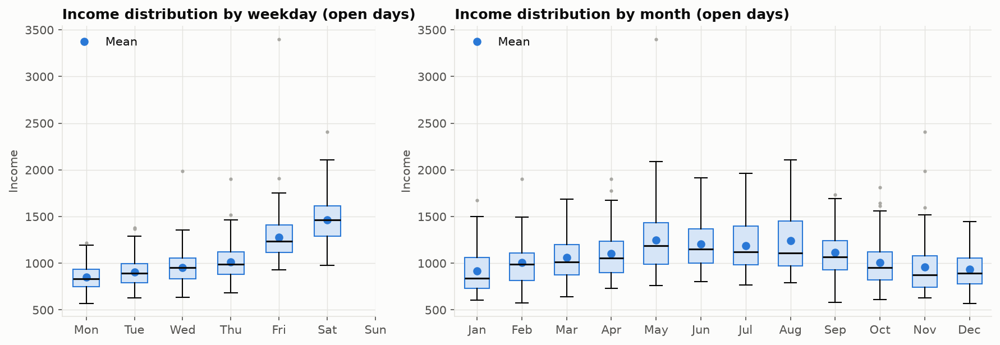

The busiest weekday on average is **Saturday** (1,461) and the quietest open day is **Monday** (849), a ratio of 1.72×. By month, mean daily income peaks in **May** (1,045) and is lowest in **Dec** (693).

| Weekday | Mean income (open days) |
|:--|--:|
| Monday | 849 |
| Tuesday | 906 |
| Wednesday | 955 |
| Thursday | 1,011 |
| Friday | 1,278 |
| Saturday | 1,461 |

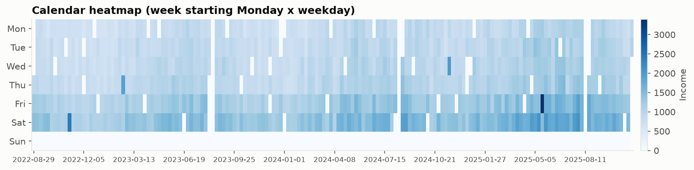

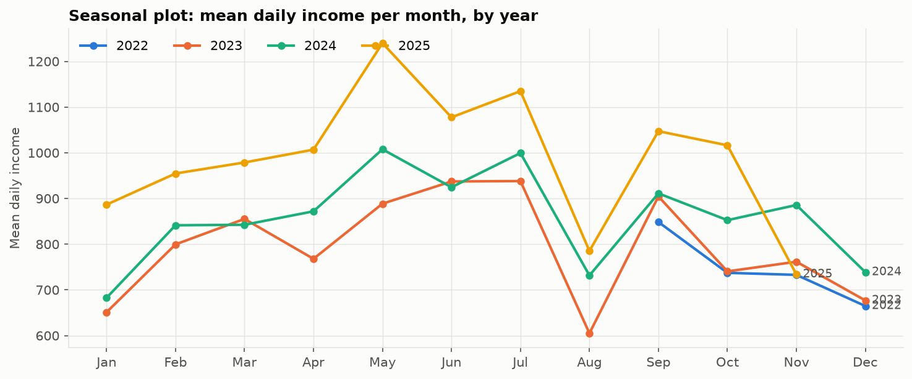

| Year | Total | Mean daily | Days | Complete year |
|:--|--:|--:|--:|--:|
| 2022 | 90,902 | 745.1 | 122 | no |
| 2023 | 289,539 | 793.3 | 365 | yes |
| 2024 | 313,699 | 857.1 | 366 | yes |
| 2025 | 316,041 | 1,003.3 | 315 | no |

## 3. Identification (Box–Jenkins)

### 3.1 Variance stabilisation

| Estimate | Value |
|:--|--:|
| Box–Cox λ (ML, open days) | -0.522 (95 % CI -0.743 – -0.304) |
| Guerrero λ (monthly blocks) | 0.090 |
| Slope of log sd on log mean | 0.983 (p = < 0.001, 39 months) |

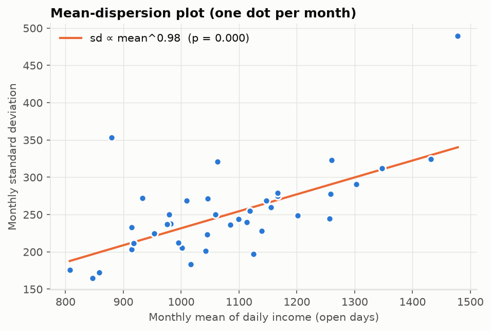

The dispersion grows with the level (significant mean–sd slope) and the Guerrero λ is well below 1, so the models are fitted on **√income** (the log is not possible because closures produce zeros); forecasts are back-transformed with bias adjustment.
A slope of 0 means constant variance (no transform), 0.5 suggests √, 1 suggests log (λ ≈ 1 − slope).
The earlier notebook used Box–Cox on income + 1, which mixes closure zeros into the estimate;
here λ is estimated on open days only.

### 3.2 Stationarity and differencing

ADF tests H₀: unit root (non-stationary); KPSS tests H₀: stationary. A series is treated as
stationary when ADF rejects **and** KPSS does not. Following the course, the variance of each
differenced series is also reported: differencing should *decrease* it; an increase signals
over-differencing.

| Series | Variance | ADF stat | ADF p | KPSS stat | KPSS p |
|:--|--:|--:|--:|--:|--:|
| W_t (levels) | 145.9 | -1.97 | 0.302 | 0.606 | 0.022 |
| ∇W_t | 338.5 | -10.68 | < 0.001 | 0.021 | 0.100 |
| ∇7W_t | 5.3 | -9.27 | < 0.001 | 0.024 | 0.100 |
| ∇∇7W_t | 8.7 | -14.50 | < 0.001 | 0.074 | 0.100 |
| ∇²∇7W_t | 25.5 | -15.39 | < 0.001 | 0.068 | 0.100 |

Seasonal strength FS = 0.98 > 0.64 → **D = 1**; KPSS on the seasonally differenced series → **d = 0**.

### 3.3 Decomposition

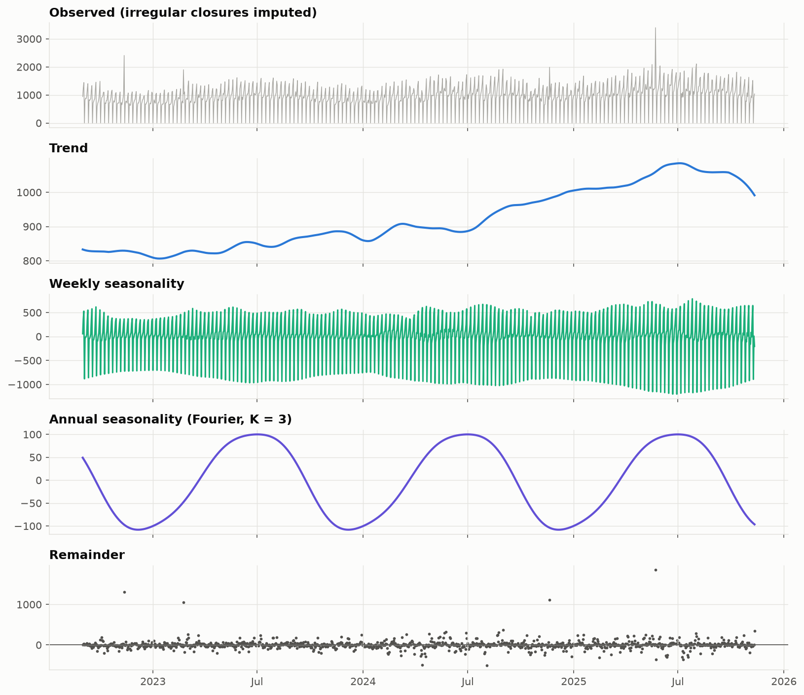

STL (period 7, 91-day trend) + annual Fourier split decomposition (robust LOESS). Strength of trend
FT = 0.37, weekly seasonality
FS,7 = 0.93,
annual seasonality FS,365 = 0.31.

### 3.4 Periodogram

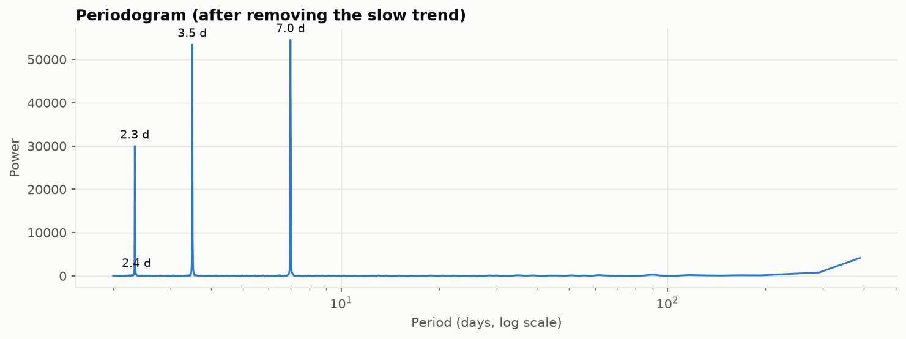

Dominant periods (days): 7.0, 3.5, 2.3, 2.4. A peak at 7 (and its harmonic 3.5) confirms the weekly
cycle that motivates s = 7.

### 3.5 ACF and PACF

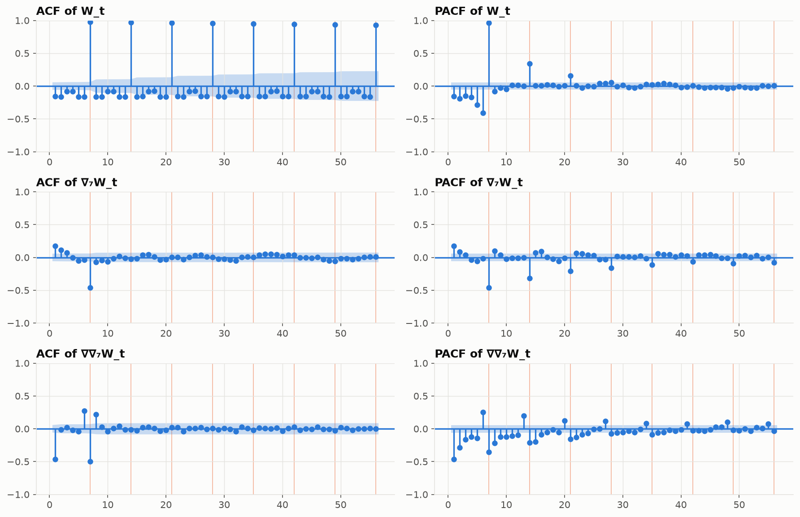

Orange lines mark the seasonal lags (multiples of 7). In the levels the ACF decays slowly at
seasonal lags (seasonal non-stationarity). After ∇₇ the pattern of significant lags at 7, 14, …
in ACF vs PACF identifies the seasonal part (a single ACF spike at 7 → seasonal MA(1); decaying
PACF at 7, 14 → seasonal MA), and the first lags identify the regular part.

### 3.6 Anomalous days

60 open days have a decomposition remainder with robust |z| > 3.5.

| Date | Weekday | Income | Robust z | Holiday |
|:--|:--|--:|--:|:--|
| 2025-05-23 | Friday | 3,399 | 32.5 |  |
| 2022-11-12 | Saturday | 2,410 | 23.0 |  |
| 2024-11-20 | Wednesday | 1,988 | 19.6 |  |
| 2023-02-23 | Thursday | 1,900 | 18.6 |  |
| 2024-08-03 | Saturday | 1,174 | -8.8 |  |
| 2024-04-13 | Saturday | 1,053 | -8.6 |  |
| 2024-08-31 | Saturday | 1,923 | 6.4 |  |
| 2025-07-10 | Thursday | 925 | -6.3 |  |
| 2025-05-24 | Saturday | 1,471 | -6.2 |  |
| 2025-11-11 | Tuesday | 1,036 | 6.1 |  |
| 2024-05-24 | Friday | 1,590 | 5.7 |  |
| 2024-08-24 | Saturday | 1,903 | 5.5 |  |

## 4. Estimation

The orders (p, q)(P, Q) were selected by AICc over a grid of 36 models with
d = 0, D = 1, s = 7, using **only data before the first
cross-validation origin** (2025-05-27), so the later evaluation is genuinely out of
sample. Holiday and closure dummies are included as regressors (regression with SARIMA errors).

| Model | k | AIC | BIC | AICc |
|:--|--:|--:|--:|--:|
| SARIMA(2,0,1)(1,1,1)7 | 8 | 4,165.1 | 4,204.3 | 4,165.2 |
| SARIMA(1,0,2)(1,1,1)7 | 8 | 4,165.9 | 4,205.1 | 4,166.1 |
| SARIMA(2,0,2)(1,1,1)7 | 9 | 4,166.1 | 4,210.2 | 4,166.3 |
| SARIMA(2,0,1)(0,1,1)7 | 7 | 4,167.2 | 4,201.5 | 4,167.3 |
| SARIMA(1,0,2)(0,1,1)7 | 7 | 4,167.8 | 4,202.1 | 4,167.9 |
| SARIMA(2,0,2)(0,1,1)7 | 8 | 4,168.6 | 4,207.8 | 4,168.7 |
| SARIMA(1,0,1)(1,1,1)7 | 7 | 4,173.6 | 4,207.9 | 4,173.7 |
| SARIMA(1,0,1)(0,1,1)7 | 6 | 4,174.7 | 4,204.1 | 4,174.8 |
| SARIMA(2,0,0)(1,1,1)7 | 7 | 4,209.5 | 4,243.8 | 4,209.6 |
| SARIMA(2,0,0)(0,1,1)7 | 6 | 4,210.3 | 4,239.7 | 4,210.4 |

- **Model 1** (lowest AICc): SARIMA(2,0,1)(1,1,1)7
- **Model 2** (lowest BIC among the rest, the parsimonious alternative): SARIMA(2,0,1)(0,1,1)7

Coefficients estimated on the full sample:

**Model 1**

| Parameter | coef | se | z | p |
|:--|--:|--:|--:|--:|
| holiday | -31.8113 | 0.1645 | -193.38 | < 0.001 |
| closure | -34.0383 | 0.3174 | -107.23 | < 0.001 |
| ar.L1 | 1.1399 | 0.0271 | 42.11 | < 0.001 |
| ar.L2 | -0.1487 | 0.0242 | -6.15 | < 0.001 |
| ma.L1 | -0.9278 | 0.0192 | -48.44 | < 0.001 |
| ar.S.L7 | 0.0670 | 0.0297 | 2.25 | 0.024 |
| ma.S.L7 | -0.9325 | 0.0163 | -57.14 | < 0.001 |
| sigma2 | 3.7554 | 0.0575 | 65.26 | < 0.001 |

**Model 2**

| Parameter | coef | se | z | p |
|:--|--:|--:|--:|--:|
| holiday | -31.7821 | 0.1626 | -195.49 | < 0.001 |
| closure | -34.0494 | 0.3077 | -110.65 | < 0.001 |
| ar.L1 | 1.1359 | 0.0272 | 41.72 | < 0.001 |
| ar.L2 | -0.1456 | 0.0244 | -5.98 | < 0.001 |
| ma.L1 | -0.9235 | 0.0191 | -48.25 | < 0.001 |
| ma.S.L7 | -0.9139 | 0.0166 | -55.10 | < 0.001 |
| sigma2 | 3.7695 | 0.0590 | 63.87 | < 0.001 |

**Other models.** ETS: additive error and seasonality, no trend
(chosen by AICc: A,Ad,A 4,009.6, A,N,A 4,006.0). Dynamic harmonic regression (DHR):
Model 1 errors plus K = 4 annual Fourier pairs (K chosen by AICc).
Gradient boosting: direct multi-horizon model on calendar features and lags ≥ horizon, with
quantile-loss models for the intervals.

## 5. Validation of the SARIMA models

### Model 1: SARIMA(2,0,1)(1,1,1)7

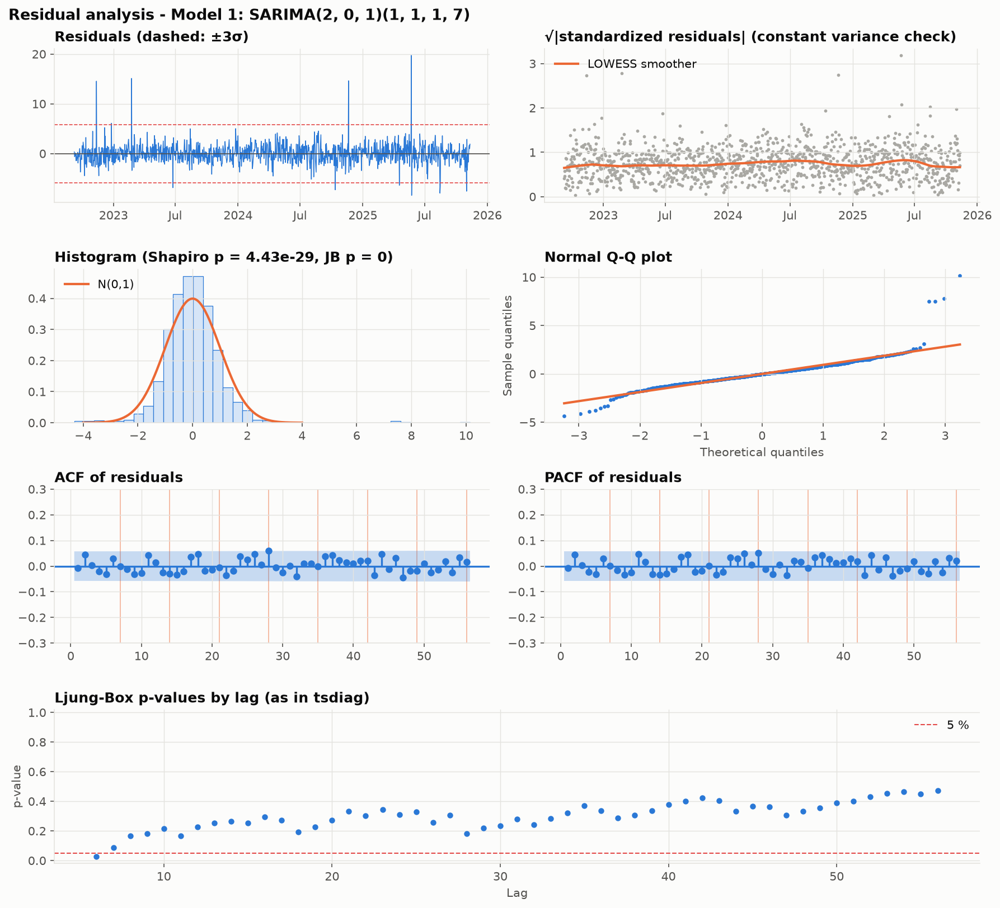

| Check | Result |
|:--|--:|
| AIC / BIC / AICc | 4,858.9 / 4,899.3 / 4,859.0 |
| AR root moduli (min) | 1.010 |
| MA root moduli (min) | 1.010 |
| Ljung–Box p (lags 7, 14, 21, 28, 42, 56) | 0.087, 0.263, 0.333, 0.180, 0.422, 0.474 |
| Shapiro–Wilk p / Jarque–Bera p | < 0.001 / < 0.001 |
| Skewness / excess kurtosis | 1.78 / 17.49 |
| ARCH LM p (7 lags) / break-variance p | 0.108 / 0.002 |

The model is causal (stationary) and invertible: all AR/MA root moduli are greater than 1. Ljung–Box does not reject white-noise residuals at any tested lag. Residuals are not normal (JB p = < 0.001, excess kurtosis 17.49), so model-based intervals should be checked against their empirical coverage. No evidence of conditional heteroskedasticity (ARCH LM). Re-estimating without the last 28 days moves the coefficients by at most 1.17 standard errors: the model is only moderately stable.

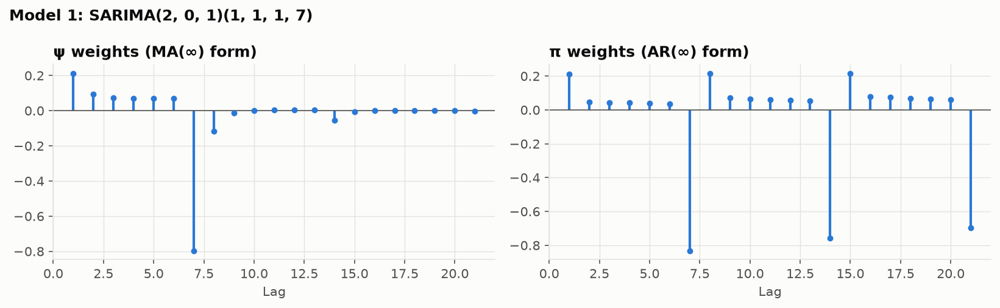

The ψ weights (MA(∞) representation) show how a shock propagates into future income; the π weights
(AR(∞) representation) show how much each past value enters the one-step forecast. Both decay to
zero, as required for a causal and invertible model.

**Stability** (coefficients with all data vs without the last 28 days):

| Parameter | full | full_se | without_last_h | shift_in_se |
|:--|--:|--:|--:|--:|
| holiday | -31.8113 | 0.1645 | -31.6182 | 1.17 |
| closure | -34.0383 | 0.3174 | -34.0415 | -0.01 |
| ar.L1 | 1.1399 | 0.0271 | 1.1452 | 0.20 |
| ar.L2 | -0.1487 | 0.0242 | -0.1542 | -0.23 |
| ma.L1 | -0.9278 | 0.0192 | -0.9324 | -0.24 |
| ar.S.L7 | 0.0670 | 0.0297 | 0.0599 | -0.24 |
| ma.S.L7 | -0.9325 | 0.0163 | -0.9274 | 0.31 |

### Model 2: SARIMA(2,0,1)(0,1,1)7

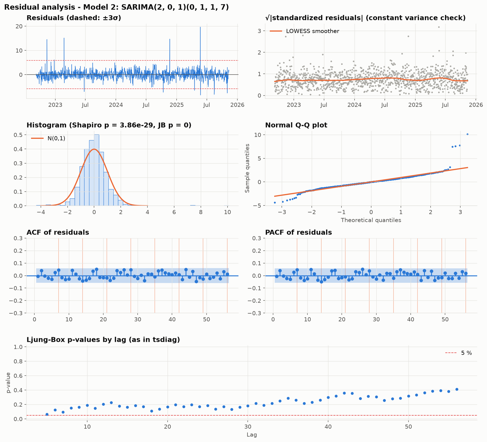

| Check | Result |
|:--|--:|
| AIC / BIC / AICc | 4,860.6 / 4,896.0 / 4,860.7 |
| AR root moduli (min) | 1.011 |
| MA root moduli (min) | 1.013 |
| Ljung–Box p (lags 7, 14, 21, 28, 42, 56) | 0.093, 0.176, 0.195, 0.132, 0.357, 0.413 |
| Shapiro–Wilk p / Jarque–Bera p | < 0.001 / < 0.001 |
| Skewness / excess kurtosis | 1.75 / 17.46 |
| ARCH LM p (7 lags) / break-variance p | 0.107 / 0.002 |

The model is causal (stationary) and invertible: all AR/MA root moduli are greater than 1. Ljung–Box does not reject white-noise residuals at any tested lag. Residuals are not normal (JB p = < 0.001, excess kurtosis 17.46), so model-based intervals should be checked against their empirical coverage. No evidence of conditional heteroskedasticity (ARCH LM). Re-estimating without the last 28 days moves the coefficients by at most 1.15 standard errors: the model is only moderately stable.

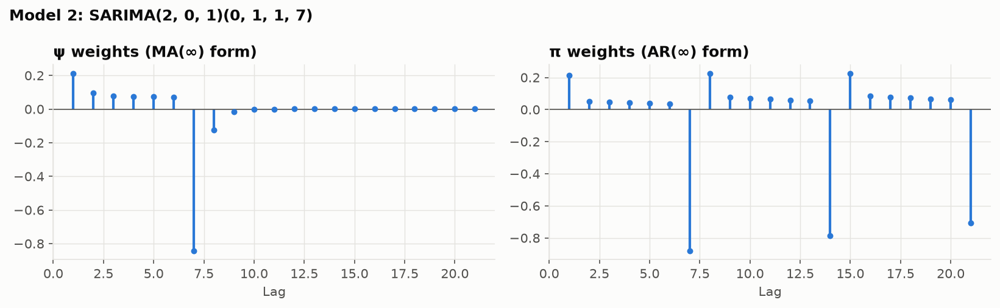

The ψ weights (MA(∞) representation) show how a shock propagates into future income; the π weights
(AR(∞) representation) show how much each past value enters the one-step forecast. Both decay to
zero, as required for a causal and invertible model.

**Stability** (coefficients with all data vs without the last 28 days):

| Parameter | full | full_se | without_last_h | shift_in_se |
|:--|--:|--:|--:|--:|
| holiday | -31.7821 | 0.1626 | -31.5944 | 1.15 |
| closure | -34.0494 | 0.3077 | -34.0530 | -0.01 |
| ar.L1 | 1.1359 | 0.0272 | 1.1419 | 0.22 |
| ar.L2 | -0.1456 | 0.0244 | -0.1517 | -0.25 |
| ma.L1 | -0.9235 | 0.0191 | -0.9285 | -0.26 |
| ma.S.L7 | -0.9139 | 0.0166 | -0.9130 | 0.06 |

## 6. Calendar effects and outliers

Public holidays (Catalonia calendar, 40 in the sample) enter SARIMA, DHR and gradient boosting as a dummy. The store was closed on 100 % of holidays falling on open weekdays, so future holidays are forecast as 0.

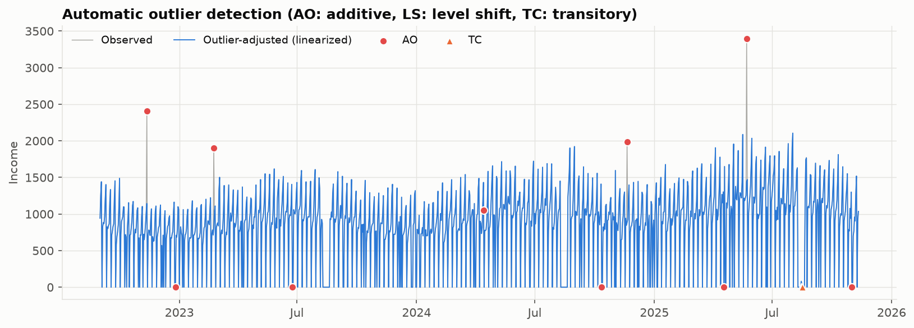

| Date | Type | Estimated effect | t |
|:--|:--|--:|--:|
| 2025-05-23 | AO | 20.3 | 16.8 |
| 2022-11-12 | AO | 15.3 | 3.8 |
| 2023-02-23 | AO | 15.2 | 2.8 |
| 2024-11-20 | AO | 14.8 | 2.4 |
| 2025-11-01 | AO | -8.7 | -1.7 |
| 2025-08-15 | TC | -9.0 | -4.3 |
| 2023-06-24 | AO | -7.7 | -2.6 |
| 2025-04-18 | AO | -7.5 | -2.0 |
| 2024-10-12 | AO | -7.5 | -5.5 |
| 2024-04-13 | AO | -5.4 | -2.8 |
| 2022-12-26 | AO | 5.3 | 0.9 |
| 2025-08-17 | TC | 5.2 | 1.1 |

12 outliers were detected on the full sample (|t| > 3.5). In the hold-out check (detection on the training part only, 12 outliers) the treatment **improves** the 28-day forecast MAE from 110 to 104, so the final SARIMA-type forecasts include the outlier regressors.

| Hold-out (28 days) | MAE | RMSE |
|:--|--:|--:|
| Without outlier treatment | 109.9 | 143.6 |
| With outlier treatment | 103.5 | 137.0 |

## 7. Forecast evaluation (rolling-origin cross-validation)

Each model is re-estimated on an expanding window and forecasts the next 28 days, for
6 consecutive origins (2025-05-27 → 2025-10-14). This
tests the models the way they will be used, instead of judging them only by in-sample fit.
Irregular closures inside the test windows (8 days) are not scored, because no
model can anticipate them. MAPE/RMSPE use days with positive income only.

| Model | MASE | MASE sd (folds) | MAE | RMSE | WAPE % | MAPE % | RMSPE % | Bias | Cov80 % | Cov95 % | Width95 | Fit time (s/fold) |
|:--|--:|--:|--:|--:|--:|--:|--:|--:|--:|--:|--:|--:|
| DHR (SARIMA + Fourier) | 0.827 | 0.223 | 79.5 | 113.6 | 7.5 | 7.8 | 10.3 | -11.7 | 86 | 97 | 542 | 3.9 |
| Ensemble | 0.881 | 0.201 | 84.8 | 119.1 | 8.0 | 8.5 | 11.3 | 12.0 | – | – | – | – |
| SARIMA (Model 2) | 0.909 | 0.246 | 87.4 | 124.2 | 8.3 | 9.1 | 12.4 | 23.7 | 86 | 95 | 584 | 1.4 |
| SARIMA | 0.919 | 0.246 | 88.4 | 124.8 | 8.4 | 9.1 | 12.3 | 20.4 | 85 | 95 | 584 | 2.0 |
| ETS | 0.977 | 0.165 | 94.1 | 129.9 | 8.9 | 9.6 | 12.7 | 37.7 | 83 | 94 | 542 | 0.1 |
| Seasonal mean | 1.072 | 0.242 | 103.0 | 143.2 | 9.7 | 10.3 | 13.4 | 46.4 | 100 | 100 | 1,745 | 0.0 |
| Gradient boosting | 1.118 | 0.228 | 107.7 | 153.5 | 10.2 | 10.3 | 13.0 | 1.7 | 79 | 91 | 1,467 | 1.7 |
| Seasonal naive | 1.601 | 1.183 | 152.7 | 321.7 | 14.4 | 13.9 | 23.7 | 65.1 | 92 | 95 | 1,007 | 0.0 |
| Naive | 2.547 | 0.603 | 245.5 | 346.2 | 23.2 | 22.1 | 26.8 | -86.4 | 99 | 100 | 3,453 | 0.0 |

MASE < 1 means more accurate than the in-sample seasonal naive forecast. Cov80/Cov95 are
empirical coverages of the 80 % / 95 % intervals; Width95 is the mean width of the 95 % interval
(the course's precision measure).

The most accurate method out of sample is **DHR (SARIMA + Fourier)** (MASE 0.827, WAPE 7.5 %), 48.3 % lower error than the seasonal naive benchmark. The Diebold–Mariano test confirms it is significantly more accurate than ETS, Gradient boosting. Its advantage over Seasonal naive, SARIMA is not statistically significant, so those are practically equivalent alternatives. Between the two Box–Jenkins candidates, Model 2 forecasts better (MASE 0.909 vs 0.919). Nominal 95 % intervals reach between 91 % and 100 % empirical coverage.

**Diebold–Mariano tests** (squared loss, HLN correction; negative = DHR (SARIMA + Fourier) better):

| DHR (SARIMA + Fourier) vs | DM statistic | p-value |
|:--|--:|--:|
| Seasonal naive | -1.04 | 0.302 |
| SARIMA | -1.22 | 0.223 |
| ETS | -3.56 | < 0.001 |
| Gradient boosting | -4.83 | < 0.001 |

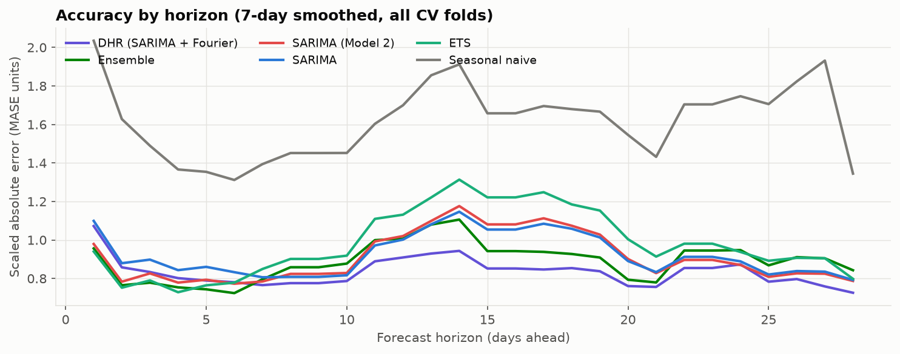

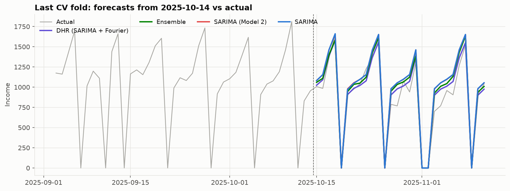

## 8. Forecast

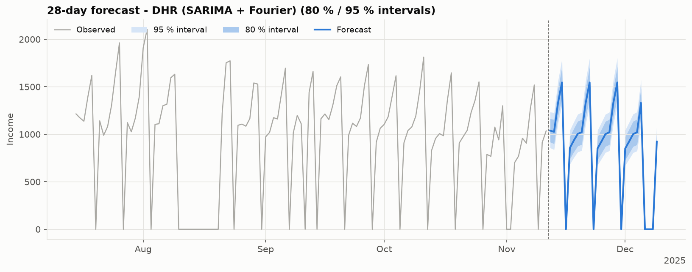

Expected income over the next 28 days: **24,359** (80 % range of the daily sums: 21,410 – 27,381), -2.6 % vs the last 28 days and 0.6 % vs the same period last year. Intervals are the model's own: their 95 % coverage in cross-validation was at least 85 %.

| Week ending | Days | Forecast income |
|:--|--:|--:|
| 2025-11-16 | 5 | 4,941 |
| 2025-11-23 | 7 | 6,693 |
| 2025-11-30 | 7 | 6,674 |
| 2025-12-07 | 7 | 5,127 |
| 2025-12-14 | 2 | 924 |

Total over the horizon according to each model (a quick check on model agreement):
Gradient boosting 25,510 · DHR (SARIMA + Fourier) 24,359 · SARIMA 24,418 · ETS 24,594 · Ensemble 24,720.

The daily values are written to `outputs/forecast.csv` (not committed).

## 9. Monthly view (SARIMA with s = 12)

The classic course workflow on monthly totals (38 complete months), with the number
of open days in each month as a trading-day regressor. Seasonal strength
FS,12 = 0.93 → D = 1; d = 1. The transformation
(none / log) and orders were chosen by AIC computed on the original scale (Jacobian-corrected).

Selected: **SARIMA(0,1,1)(0,1,0)12**.
Trading-day coefficient: 881.94 per open day
(p = < 0.001). Ljung–Box p (lag 24) = 0.753.

| Hold-out last 12 months | MAE | RMSE | MAPE % |
|:--|--:|--:|--:|
| SARIMA | 2,381 | 2,750 | 7.7 |
| Seasonal naive | 4,115 | 4,406 | 13.5 |

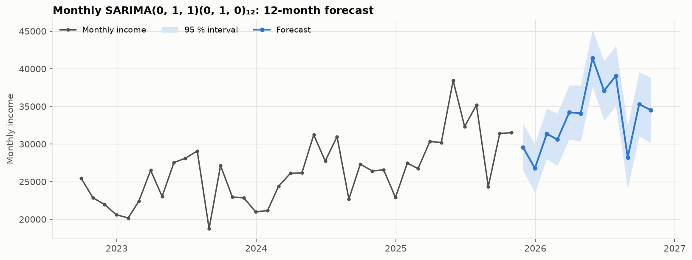

| Month | mean | lo80 | hi80 | lo95 | hi95 |
|:--|--:|--:|--:|--:|--:|
| 2025-11 | 29,568 | 27,551 | 31,585 | 26,483 | 32,653 |
| 2025-12 | 26,779 | 24,674 | 28,884 | 23,560 | 29,998 |
| 2026-01 | 31,362 | 29,173 | 33,551 | 28,014 | 34,709 |
| 2026-02 | 30,609 | 28,340 | 32,879 | 27,138 | 34,081 |
| 2026-03 | 34,222 | 31,874 | 36,570 | 30,631 | 37,813 |
| 2026-04 | 34,083 | 31,660 | 36,507 | 30,377 | 37,790 |
| 2026-05 | 41,435 | 38,938 | 43,932 | 37,617 | 45,254 |
| 2026-06 | 37,089 | 34,521 | 39,657 | 33,161 | 41,017 |
| 2026-07 | 39,060 | 36,422 | 41,697 | 35,026 | 43,093 |
| 2026-08 | 28,220 | 25,515 | 30,925 | 24,083 | 32,357 |
| 2026-09 | 35,296 | 32,525 | 38,067 | 31,058 | 39,534 |
| 2026-10 | 34,503 | 31,668 | 37,339 | 30,167 | 38,840 |

## 10. Conclusions and recommendations

1. **Structure.** Income is dominated by the weekly cycle (FS,7 = 0.93).
   The busiest weekday on average is **Saturday** (1,461) and the quietest open day is **Monday** (849), a ratio of 1.72×. A linear fit to the monthly means gives an upward trend of 81.8 per day per year (9.5 % of the mean level, HAC p = < 0.001), which is statistically significant. Income over the last 12 months is 16.2 % above the previous 12 months.
2. **Model.** The most accurate method out of sample is **DHR (SARIMA + Fourier)** (MASE 0.827, WAPE 7.5 %), 48.3 % lower error than the seasonal naive benchmark. The Diebold–Mariano test confirms it is significantly more accurate than ETS, Gradient boosting. Its advantage over Seasonal naive, SARIMA is not statistically significant, so those are practically equivalent alternatives. Use it for the operational 28-day forecast; the ensemble and the
   SARIMA are robust fall-backs.
3. **Uncertainty.** Intervals are the model's own: their 95 % coverage in cross-validation was at least 85 %. Plan staffing and stock against the 80 % band, not the point
   forecast alone.
4. **Keep it updated.** Append new days to the CSV and re-run `python3 run_analysis.py`; orders are
   re-selected and all models re-evaluated automatically.
5. **Possible improvements.** Add a file of *known future closures* (vacations) and promotions as
   regressors; add weather or local events if they drive footfall; model the share of card vs
   cash payments if available.

## Appendix: methods

| Method | Role | Reference idea |
|:--|:--|:--|
| Box–Cox (ML) and Guerrero λ, mean–sd plot | Variance stabilisation | Box & Cox 1964; Guerrero 1993 |
| ADF, KPSS, variance of differences | Choice of d, D | Dickey–Fuller; Kwiatkowski et al. 1992 |
| STL / MSTL, seasonal strength | Decomposition, choice of D | Cleveland et al. 1990; Wang, Smith & Hyndman 2006 |
| Periodogram | Detect cycles | Spectral analysis |
| SARIMA with regressors | Box–Jenkins model (two candidates) | Box & Jenkins |
| Root moduli, ψ/π weights | Causality, invertibility | — |
| Ljung–Box, Shapiro–Wilk, Jarque–Bera, ARCH LM, √\|e\| smoother | Residual validation | — |
| AO / LS / TC detection | Outlier treatment (iterative, π-weighted) | Chen & Liu 1993 |
| Holiday dummies | Calendar effects | — |
| Dynamic harmonic regression | Annual cycle with Fourier terms + SARIMA errors | Hyndman & Athanasopoulos, FPP3 |
| ETS (A, Ad, A) | Exponential smoothing state-space model | Hyndman et al. 2008 |
| Gradient boosting (direct, quantile loss) | Machine-learning comparison | Friedman 2001 |
| Ensemble (mean of ETS, SARIMA, DHR, GBM) | Forecast combination | Bates & Granger 1969 |
| Rolling-origin CV, MASE, WAPE, coverage | Out-of-sample evaluation | Tashman 2000; Hyndman & Koehler 2006 |
| Diebold–Mariano (HLN) | Significance of accuracy differences | Diebold & Mariano 1995 |
